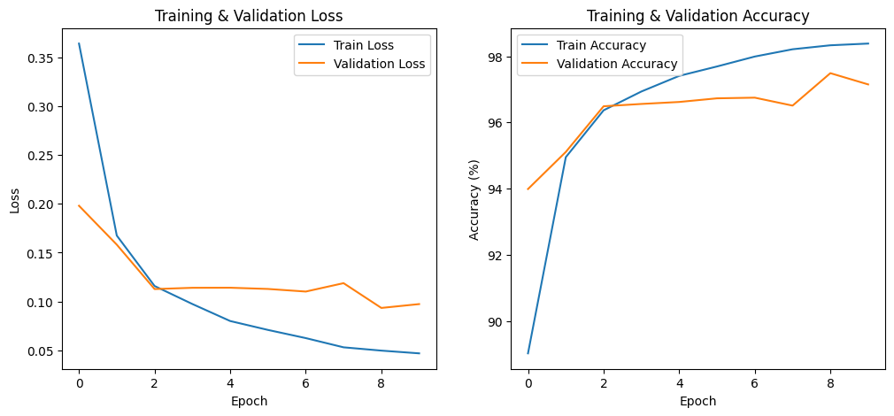

# MNIST Veri Seti ile MLP Tabanlı El Yazısı Rakam Tanıma

Bu proje kapsamında, PyTorch kullanılarak CNN (Evrişimli Sinir Ağı) mimarisi **kullanılmadan**, temel bir Multi-Layer Perceptron (MLP) modeli sıfırdan oluşturulmuş ve MNIST veri seti üzerinde eğitilmiştir. 

## 1. Kullanılan Hiperparametreler ve Model Mimarisi
* **Batch Size:** 64
* **Epoch:** 10
* **Learning Rate:** 0.001
* **Optimizer:** Adam
* **Loss Fonksiyonu:** CrossEntropyLoss
* **Model Mimarisi:** Girdi Katmanı (Flatten, 784) -> Gizli Katman 1 (256 Nöron, ReLU) -> Gizli Katman 2 (128 Nöron, ReLU) -> Çıktı Katmanı (10 Sınıf)

## 2. Eğitim Sonuçları (10. Epoch Sonu)
* **Training Loss:** 0.0470
* **Training Accuracy:** %98.38
* **Validation Loss:** 0.0974
* **Validation Accuracy:** %97.15
* **Test Veri Seti Başarısı:** %97.36
* **Toplam Eğitim Süresi:** 170.03 saniye

## 3. Loss ve Accuracy Grafikleri
Eğitim süresince elde edilen Training ve Validation (Kayıp ve Doğruluk) değerlerinin grafiği aşağıdadır:

## 4. Kendi El Yazım (Öğrenci Numarası) ile Model Testi ve Değerlendirme
Modelime öğrenci numaramın (24120205018) el yazısı ile yazılmış halini yükledim. Modelim MNIST eğitim ve test verilerinde yüksek başarı (%97.36) göstermiş olsa da, kendi el yazımla hazırladığım okul numaramın rakamlarını modele test verisi olarak verdiğimde bazı hatalı tahminler gözlemledim.

**Genel Değerlendirme (Distribution Shift & Generalization):**
Bu hatanın temel sebebi, eğitim verisi ile gerçek dünya verisi arasındaki **dağılım kaymasıdır (distribution shift)**. Model sadece bilgisayar ortamındaki idealize edilmiş MNIST rakamlarını öğrenmiştir. Benim çektiğim fotoğraflardaki kalem kalınlığı, ışık, rakamın kağıttaki açısı ve konumu model için yeni bir gürültü (noise) yaratmıştır. 

Ayrıca ödevin kuralı gereği CNN yerine temel MLP kullanıldığından, `Flatten` işlemi görüntünün 2 boyutlu uzaysal (spatial) bilgisini yok etmiştir. Rakamın kağıt üzerindeki ufak bir piksel kayması, modelin o rakamı tamamen farklı bir sınıfa atamasına sebep olmuştur. Bu durum, eğitim verisindeki yüksek doğruluk oranlarının, gerçek dünya verisine her zaman doğrudan genellenemeyeceğini (generalization problemi) açıkça göstermektedir.
